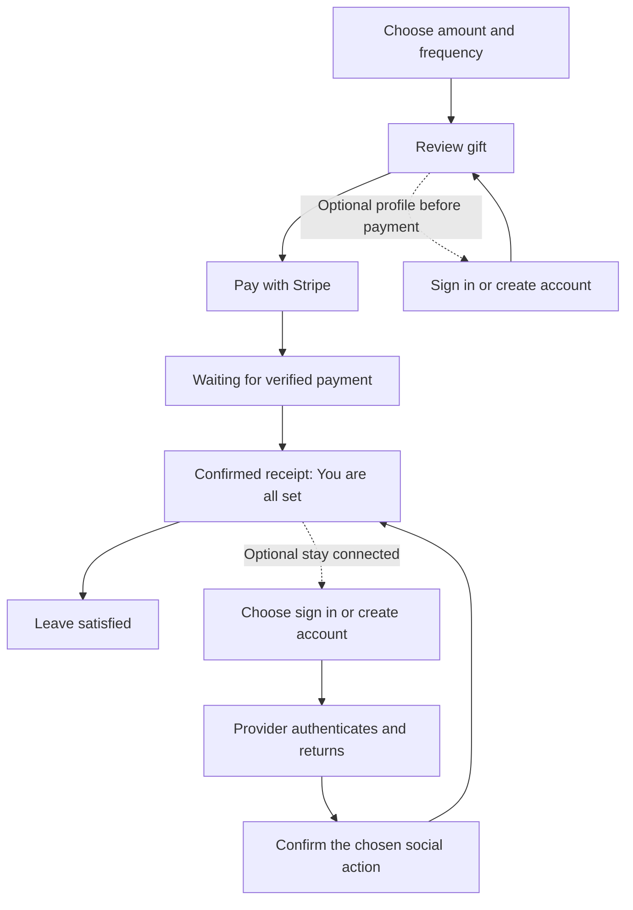

# Bluesky onboarding and guest tipping

Exploration · 2026-10-12 · Proposed direction, not an implemented redesign

## Problem and executive summary

A visitor comes to Feedme to support someone. They should be able to choose an amount, understand the charge, pay, and leave satisfied. Learning about Bluesky should be an optional continuation of that experience.

**Keep Bluesky as the only promoted social sign-in, retain compatible AT Protocol accounts, and make guest tipping a complete product experience.** Do not add Google or Twitter/X authentication now. A person should never need a social account to give once, give regularly, or stop renewing.

The preferred journey is **choose → review → pay → thank you**. After confirmation, offer one quiet invitation to stay connected. Explain Bluesky through the thing someone wants to do: follow this creator, use a recognizable profile, or share a message. They do not need to adopt a new social-network habit to use an account here.

The most useful next work is:

1. Simplify the existing review, receipt, and login screens around one purpose each.
2. Test provider-hosted Bluesky signup that returns directly to the saved context.
3. Reduce permissions requested for identity-only sign-in, separately from optional social actions.

Attaching an identity to an already-paid guest tip is a separate product feature. Do not imply that ordinary sign-in already does this, or make it a dependency of the first release.

## Current state in the repository

Code inspected at `0e90085` on 2026-10-12. This is a source snapshot, not a claim about what is deployed.

| Area | Observed behavior | Implication |
| --- | --- | --- |
| [Gift form](../../src/components/PickVisit.astro) | Guest/anonymous is the default; note and sharing settings are collapsed; payment comes before the catalog on mobile. | Preserve this foundation. |
| [Saved review](../../src/lib/pick-checkout.ts) | Browser-bound reviews last one hour. A privacy change creates a new review; amount, picks, schedule, and note survive. | Existing state preservation is useful for onboarding. |
| [Review screen](../../src/pages/checkout/review.astro) | Guests can continue to Stripe or optionally sign in and attach a profile privately before paying. | Keep the optional path discoverable without giving it equal visual weight to payment. |
| [Checkout API](../../src/pages/api/checkout.ts) | One-time and recurring gifts can be anonymous. Named gifts require a DID. | Guest support is already real, not a proposed shortcut. |
| [Login](../../src/pages/login.astro) | Handle entry, signup guidance, guest guidance, protocol explanation, and product explanation occupy the same screen. | Several helpful explanations compete with the immediate task. |
| [Signup component](../../src/components/BlueskySignup.astro) | Opens `bsky.app` in another tab; asks the visitor to return and enter their new handle. | This is the largest avoidable continuity gap. |
| [OAuth](../../src/pages/auth/login.ts) | Requires a handle/DID and requests `atproto transition:generic`. | The UI is narrower than the SDK, while permissions are broader than identity alone needs. |
| [Receipt](../../src/pages/thanks.astro) | Shows verified support, then combinations of breakdown, share card, follow, signup, posting, recommendations, and discovery. | Payment completion needs a clearer stopping point. |
| [Receipt authority](../../src/lib/tip-sharing.ts) | Access requires the original checkout browser or the DID attached to a non-anonymous gift. | A receipt URL alone cannot prove ownership. |
| [Billing](../../src/pages/billing.astro) | Browser/DID access can open billing; a configured Stripe portal also offers checkout-email recovery. | Account-free recurring support must remain manageable after cookies disappear. |

The chats **“Fix tip amount and Bluesky login UX”** and **“Clarify independent work purpose”** already cover the amount-entry bug, OAuth callback state handling, optional sign-in at review, the support heading, and default project selection. This exploration builds on that work. It does not propose repeating those fixes. Their requests to deploy are separate from this planning task.

Existing architectural context: [social protocol and onboarding](../social-protocol.md), [recurring support](../recurring-support.md), and [privacy behavior](../../src/pages/privacy.astro).

## Key findings

### Tipping, identity, and publication are separate choices

Paying does not require a social identity. Signing in does not itself make a payment, attach a profile to a past anonymous gift, follow someone, or publish anything. Publicly acknowledging a gift and posting to Bluesky are also different actions.

Those distinctions must stay true in the implementation, but the visitor does not need to study all of them before paying. Reveal each explanation at its decision point.

Use **“No account needed”** as the positive default message. “Anonymous” is a technical visibility setting and can suggest that the creator cannot know who paid. Keep the precise clarification nearby when privacy is discussed: **“Your Bluesky profile isn’t attached. Stripe and the creator may still receive billing details.”**

Someone who just wants the creator to know their name can already sign a private note. A self-written name is not a verified social profile and should never be presented as one. There is no need to add another mandatory field or another login provider to enable that courtesy.

### A receipt should make it comfortable to leave

The guest has completed the task once payment is confirmed. Signup conversion is secondary. Avoid a “finish setting up your account” step, a compulsory Continue button, or a screen that makes the gift look incomplete until a profile is connected.

The current receipt's discovery section also renders while payment is unconfirmed. Remove competing social invitations from pending/error states. Distinguish a real pending payment from an inaccessible receipt, a failed payment, and a later refund or dispute; these should not all read “Confirming your payment.”

### Bluesky can provide more than a familiar login button

Feedme already uses a supporter's AT Protocol identity for recognizable profiles and public social records. Its creator follows are Bluesky follows; its project follows appear in Feedme's Following page. Do not promise project-specific Bluesky notifications or email updates.

Google login could authenticate a Google identity, but Feedme would still need a connected AT Protocol identity for its existing social actions. Adding a second account system introduces linking, recovery, and permission rules without improving the default guest payment path. This is an architectural inference from the current DID-based model, not a measured conversion result.

“Bluesky first” should not become a new restriction on compatible AT Protocol accounts. Keep their handle/DID route available under **“Use another AT Protocol account.”** Authentication compatibility and support for every Bluesky social feature should be tested separately.

## External research

### A return-to-site signup path is worth testing

The AT Protocol OAuth specification permits starting with a provider URL instead of a known handle. It also permits identity-only authentication using the `atproto` scope. [OAuth specification](https://atproto.com/specs/oauth#identity-authentication).

On 2026-10-12, a direct read of Bluesky's public authorization-server metadata returned `prompt_values_supported` including `create`, `login`, and `select_account`. This is concrete evidence of an advertised signup option. It is **not** verification that a new person can finish signup and return successfully in every browser. [Live provider metadata](https://bsky.social/.well-known/oauth-authorization-server).

The installed `@atproto/oauth-client-node` 0.5.7 uses `@atproto/oauth-client` 0.8.7. Its `OAuthResolver.resolve` accepts a PDS/entryway URL, and `authorize` forwards authorization options through PAR. Feedme's own handle validation currently prevents using that route. A small, isolated integration experiment is justified before adopting a new auth library or building an account-creation service.

Fallback signup at `bsky.app` remains available without an invitation. Preserve the current receipt in its original tab, label the new-tab behavior, and offer **“I have an account now”** there. Do not promise a signup duration or guaranteed automatic return for the fallback. [Bluesky user FAQ](https://bsky.social/about/blog/5-19-2023-user-faq).

### Permission requests are part of the experience

The existing `transition:generic` grant includes broad repository writes and other account permissions. Identity-only login does not require that scope. Separate authentication from action permissions; investigate fine-grained grants for follows and posts, and verify provider support rather than assuming it. [OAuth scopes](https://atproto.com/specs/oauth#authorization-scopes), [permission specification](https://atproto.com/specs/permission).

Do not describe the current grant as read-only. A reassuring sentence on Feedme will not resolve a surprising provider consent screen. Scope reduction needs its own regression work across the social adapter, creator/admin workflows, token replacement, and reconnect behavior.

### Guest billing already has a suitable recovery mechanism

Stripe's hosted portal can email a sign-in link to the customer's checkout email. With duplicate customer records sharing an email, Stripe selects the most recently created customer with an active subscription. Test this edge case: email recovery must not be described as a complete history across all customer records or independently hosted creators. [Stripe portal setup](https://docs.stripe.com/customer-management/activate-no-code-customer-portal).

The repository enables a portal login page in [billing.ts](../../src/lib/billing.ts) and ensures its configuration before recurring Checkout. Keep this payment-specific recovery route visible in billing and the recurring receipt. It is not a second Feedme social account.

Guest receipt access is not permanent: the checkout-owner binding currently lasts seven days for a one-time gift and 365 days for recurring support; losing the browser cookie can end access sooner. Do not promise that saving a receipt URL preserves access indefinitely or works across devices. Verify any emailed-receipt promise against the operator's actual Stripe configuration. If billing recovery is unavailable, provide the creator's support route without suggesting another payment or compulsory Bluesky signup.

### Google auth solves a different identity problem

Google's OpenID Connect flow returns a Google account identifier, and requires application credentials and redirect configuration. Connecting it to Feedme's AT Protocol social identity would be an additional product decision. [Google OpenID Connect](https://developers.google.com/identity/openid-connect/openid-connect).

The reason to defer Google and Twitter/X is product scope and the existing guest path, not a claim that those providers are inherently inferior. There is no need for a comparison of social networks inside checkout.

## Options and tradeoffs

| Option | Benefit | Cost or limitation | Recommendation |
| --- | --- | --- | --- |
| Guest payments plus optional Bluesky | Fewest account decisions; fits existing social features. | New social users still need onboarding if they want those features. | Adopt. |
| Add Google and/or Twitter/X login | Familiar sign-in for some returning visitors. | Additional identity linking, recovery, provider configuration, and UI; does not supply an AT Protocol identity. | Defer until a demonstrated account use case needs it. |
| Require Bluesky before payment | Every supporter has a social identity. | Signup becomes a condition of giving. | Reject for this product. |
| Feedme creates or hosts accounts directly | More control over signup presentation. | Account lifecycle, abuse prevention, credential handling, and recovery become Feedme responsibilities. | Avoid in this onboarding pass. |
| Add Feedme email accounts | Could support private cross-device features later. | A new identity system when billing already has recovery. | Revisit only with a concrete feature need. |

Sharing a creator's public page on Twitter/X, Google-connected services, or elsewhere does not require Feedme authentication with those services. A generic **Copy creator link** can serve that need. Never substitute a private receipt URL. Existing support cards are for eligible public gifts only.

## Recommended screen flow



### 1. Choose and review the gift

Keep the creator and purpose prominent: **“Support Alex's independent work.”** Offer the amount and frequency, default to a one-time gift, and let the existing “No preference” behavior handle visitors who do not want to allocate among projects. Do not add a social-provider picker.

The main form action remains **“Review your tip.”** Supporting copy: **“No account needed.”** Keep the optional note available without sign-in. Advanced public-sharing choices can stay under a disclosure; no default-public experiment is proposed.

At review, show the recipient, amount, frequency, allocations, and any publication choice before **“Continue to payment.”** Add **“Secure checkout with Stripe”** as supporting text. The actual charge happens on Stripe; avoid a button label that implies the review submit has already sent money.

Below it, use a quiet link: **“Add my Bluesky profile — optional.”** This satisfies people who want the creator to recognize them without turning login into an equally prominent alternative to paying. Preserve the current private attachment behavior, reviewed DID, and fresh review before checkout. Signed-in guests should still be able to leave their profile unattached.

For recurring support, clearly state **“$20 each month until canceled”** and show how to manage it without an account. Keep amount and interval equally visible on mobile.

### 2. Confirm the payment

Suggested copy, with fictional values:

> **Thank you, your $20 tip to Alex is confirmed.**
>
> You're all set.

Keep receipt details and, when applicable, **Manage recurring support** readily accessible. A **Back to Alex's page** link provides an ordinary exit. A receipt does not need a dominant next-step button.

While waiting, say **“We're confirming your payment. You don't need to pay again.”** Offer **Check payment status**, with optional bounded polling and an accessible status announcement as progressive enhancement. On a prolonged delay, offer the creator's support route. Show an inaccessible-receipt message when authority is missing; do not disclose payment details or claim that a payment is pending.

Show no signup invitation until the server confirms payment. The browser redirect remains navigation, never proof of payment.

### 3. Offer one optional continuation

Below the completed receipt, offer a collapsed **“Stay connected — optional”** section. On expansion:

> **Follow Alex's work on Bluesky.**
>
> Use a free Bluesky account to stay connected. You don't need to post or build a following.
>
> **Sign in with Bluesky**
>
> New here? **Create a Bluesky account**

Before the actual follow, disclose that it is public. Returning from OAuth should show the chosen profile and **Follow Alex** confirmation, with **Not now** available. If already following, show that state; if signed in already, skip authentication.

Move recommendations, creator discovery, and public-post composition behind separate intentional actions instead of presenting all of them on the default receipt. Existing public-card access can live under **Share your support**. Do not change the gift's existing publication consent while simplifying its presentation.

This first pass offers social connection, not retroactive identity attachment. The receipt can continue to explain: **“Connecting Bluesky doesn't change this tip's privacy.”**

### 4. Make authentication preserve the task

Test a simple **Continue with Bluesky** action that starts at the known Bluesky provider, avoiding mandatory handle recall. Keep **Use my handle or another AT Protocol account** available for custom providers, custom-domain handles, and people who prefer explicit account selection.

For signup, test an ordinary form that initiates provider-hosted account creation and returns through the same validated callback. Feedme should not ask for a Bluesky password, invent an undocumented signup redirect, or assume that opening `bsky.app` establishes a Feedme session.

Show only context-specific reassurance:

- Before payment: **“Your tip is saved. You'll review it after signing in.”**
- After payment: **“Your tip is complete. This connects your Bluesky account.”**
- After a canceled social sign-in: **“Sign-in wasn't completed. Your tip is still confirmed.”**

Keep a clear **Back to your receipt** or **Continue without a profile** action. Do not show an already-paid visitor instructions to tip again. If a review expires, say that the review expired; do not imply the payment failed or automatically create another charge.

```mermaid
sequenceDiagram
  participant V as Visitor
  participant F as Feedme
  participant B as Bluesky provider
  V->>F: Choose Create account from confirmed receipt
  F->>F: Store browser-bound return context and expiry
  F->>B: SDK authorization with provider URL and create prompt
  V->>B: Complete signup and review permissions
  B-->>F: OAuth callback
  F->>F: SDK verification plus application/browser binding
  F-->>V: Return to receipt and intended action
  V->>F: Explicitly confirm Follow Alex
  F->>B: Authorized follow operation
  F-->>V: Following confirmed; payment unchanged
```

### 5. Explain why Bluesky in one short paragraph

Suggested optional explainer:

> Bluesky gives you a profile you can use here and across compatible independent apps. Follow the people whose work you support without creating a new social identity for every creator. You can tip without an account, and connecting one never posts for you automatically.

This describes the proposed experience and the repository's explicit-action policy. It is not a promise of universal compatibility, universal single sign-on, or shared billing across Feedme instances. Provider sessions may reduce repeat login work; individual creator sites still have their own authorization and payment records.

Keep the fuller protocol, provider, and storage explanation on `/bluesky` and `/privacy`. Do not put Habitat, DIDs, scopes, or a Google-versus-Twitter argument in the normal payment path.

## Implementation boundaries and example code

Keep the Astro forms and server-rendered pages. A redesign does not require a client-side onboarding wizard. Small browser enhancements should preserve keyboard use, browser Back, and the no-JavaScript payment path.

The domain model should keep payment status, receipt authority, session identity, and chosen social action separate. A pure presentation function can make the completion boundary explicit:

```ts
type ReceiptState =
  | { kind: 'unavailable' }
  | { kind: 'pending' }
  | { kind: 'failed' }
  | { kind: 'adjusted'; label: string }
  | { kind: 'confirmed'; recurring: boolean };

const receiptView = (state: ReceiptState) => ({
  title: state.kind === 'confirmed' ? 'Thank you. You’re all set.'
    : state.kind === 'pending' ? 'Confirming your payment'
    : state.kind === 'failed' ? 'Payment was not completed'
    : state.kind === 'adjusted' ? state.label
    : 'This receipt is not available here',
  offerSocialConnection: state.kind === 'confirmed',
  offerBilling: state.kind === 'confirmed' && state.recurring,
});
```

This is illustrative, not a replacement for payment reconciliation. Resolve access before constructing the state; handle partial refunds, full refunds, disputes, and renewal status deliberately. Billing access must also remain available on `/billing` when a receipt is unavailable or a previous payment was adjusted.

The provider experiment can reuse the installed SDK:

```ts
// Inside the existing server-side login flow, after creating its
// random application state, browser binding, and safe return path.
const authorizationUrl = await client.authorize('https://bsky.social', {
  state: applicationState,
  scope: 'atproto',
  prompt: 'create',
});
```

This demonstrates identity-only signup. It does not grant permission to follow or post. Validate the full round trip before shipping it, preserve the SDK's issuer/DID checks, and handle the requested social action separately. Do not silently downgrade an existing social session when replacing its grant; store and check granted permissions and reauthorize explicitly when necessary.

Use a fixed server-side provider choice for the simple Bluesky button, while retaining SDK resolution for user-supplied handles/DIDs. Keep the middleware's same-origin form protection, safe local return paths, opaque OAuth state, and callback replay protection. Never put a private note, amount, payment identifier, or receipt URL into provider-visible application state or analytics.

The current OAuth application binding expires after ten minutes. A new-account signup can outlast that. Decide an explicit bounded lifetime for signup context, and make expiry recovery preserve the receipt or gift without weakening callback checks. Concurrent tabs currently share one OAuth cookie; test cancellation, retries, and overlapping sign-ins.

### Optional later feature: attach a profile to a past tip

Defer this until there is evidence people need it. If added, make it a separate **“Add my profile to this tip for Alex only”** confirmation after sign-in. Require the original checkout authority as well as the authenticated DID; a support ID, matching email, or successful OAuth alone is insufficient.

Prefer a separate private association record rather than rewriting the paid financial intent or its original visibility. Define how that association appears in private receipts/admin views, how it survives recovery, and how someone removes it. It must not automatically claim other gifts, change public totals, publish a record, or change recurring renewals. A single-gift association should say so explicitly. A public change needs its own preview and consent.

## Implementation checklist

### Pass 1 — simplify the existing experience

- [ ] Preserve guest one-time and recurring checkout, optional private profile attachment, and all current publication consent.
- [ ] Reduce review to one dominant payment action and a secondary profile link.
- [ ] Make receipt states accurate: confirmed, pending, failed, adjusted, and inaccessible.
- [ ] Replace the receipt's default stack of social prompts with one optional continuation.
- [ ] Make login/error copy depend on whether the visitor is before or after payment.
- [ ] Keep guest billing and checkout-email recovery easy to find; include missing-portal and duplicate-customer handling.
- [ ] Update the static demo, `/bluesky` guide, and affected [LibCard contracts](../../scripts/check-libcard.mjs) with the same vocabulary.

### Pass 2 — prove seamless account creation

- [ ] Test provider-URL sign-in and `prompt: 'create'` using the installed SDK on a public HTTPS test origin.
- [ ] Complete a human-authorized test signup and verify return, decline, cancellation, and timeout on desktop and mobile browsers.
- [ ] Verify ordinary Bluesky handles, custom-domain handles, and a compatible non-Bluesky provider such as the reported Tangled account.
- [ ] Preserve the exact review/receipt and chosen action through signup; show the identity before any action confirmation.
- [ ] Retain an explicit fallback if the provider does not complete the signup callback.
- [ ] Adjust expiry and concurrent-tab handling based on observed behavior, preserving browser binding.

### Pass 3 — align permissions with intent

- [ ] Inventory social and admin operations currently using `transition:generic`.
- [ ] Prove identity-only sessions work for profile attachment and existing receipt authority rules.
- [ ] Test action-specific permission requests and truthful consent copy; handle denied or missing grants.
- [ ] Verify session upgrade/replacement, reconnect, and provider differences without breaking follows, posts, or operator tools.

Keep historical profile attachment and additional login providers out of these passes unless the product decision changes.

## Validation checklist

### Exploration evidence

- [x] Inspect guest checkout, review preservation, OAuth, receipt authority, signup, and billing code.
- [x] Inspect the two related chats and account for their existing fixes.
- [x] Read Bluesky's live authorization metadata and inspect installed SDK support for provider URLs and authorization options.
- [x] Check primary documentation for AT Protocol identity, permissions, signup availability, and Stripe email-based billing access.
- [x] Separate proposed behavior from implemented behavior and provider capability from a completed signup test.
- [x] Validate local document references and run the repository baseline: `pnpm check`, all 452 tests across 57 files, and `pnpm build` pass. These checks do not validate the proposed external signup journey.

### Acceptance tests for implementation

- [ ] A new visitor can send a one-time tip without encountering a required login or social-signup screen.
- [ ] A new visitor can start, recover access to, and stop recurring support without Bluesky, including from a different browser.
- [ ] Changing the amount and pressing Enter still reviews the intended gift, with JavaScript disabled as well as enabled.
- [ ] Failed or canceled OAuth preserves the gift; canceled OAuth after payment never suggests paying again.
- [ ] Signup completion returns to the intended context; signup failure or expiry leaves the payment untouched.
- [ ] No profile, follow, post, or public acknowledgment is created merely by signing in.
- [ ] A pending redirect cannot render payment success or expose receipt details to a different browser.
- [ ] Repeated submit/callback/webhook delivery cannot duplicate a payment or an explicitly confirmed social action.
- [ ] Existing private/public gift choices and public-card allowlists remain correct; private notes and billing identifiers stay private.
- [ ] Mobile, keyboard, zoom, screen-reader status messages, browser Back, and the plain-form fallback remain usable.
- [ ] `pnpm check`, `pnpm test`, and `pnpm build` pass before an implementation ships; run affected LibCard/static export checks when their surfaces change.

### Evaluate whether the experience is actually better

Test the proposed copy with people who have Bluesky, people who do not, and people who never want it. Give them tasks to tip, optionally follow, and cancel a recurring gift. Observe where they pause and ask afterward whether they thought signup was required or whether anything became public.

The primary outcome is completed, understood payments with few mistakes. Secondary outcomes are successful voluntary connections and fewer lost returns from authentication. Treat **leaving immediately after a confirmed tip as success**. Measure verified payments rather than thank-you-page visits, and compare similar traffic periods before claiming a conversion gain.

If adding telemetry, keep coarse event counts private to the instance with bounded retention. Do not collect handles, DIDs, receipt/review tokens, notes, email addresses, or full URLs in an onboarding funnel. Small-volume creator sites may learn more from a few observed sessions than from an underpowered conversion comparison.

## References and next action

- [Current social architecture](../social-protocol.md)
- [Guest and recurring payment behavior](../recurring-support.md)
- [AT Protocol overview](https://atproto.com/guides/overview)
- [AT Protocol OAuth](https://atproto.com/specs/oauth)
- [AT Protocol permissions](https://atproto.com/specs/permission)
- [Bluesky authorization metadata](https://bsky.social/.well-known/oauth-authorization-server)
- [Bluesky user FAQ](https://bsky.social/about/blog/5-19-2023-user-faq)
- [Stripe customer portal](https://docs.stripe.com/customer-management/activate-no-code-customer-portal)
- [Google OpenID Connect](https://developers.google.com/identity/openid-connect/openid-connect)

Start with the receipt and review hierarchy in Pass 1, then test the provider signup round trip before choosing its final UI. The decision to reconsider another login provider should follow evidence of an unmet account need, not the mere presence of visitors without Bluesky.
