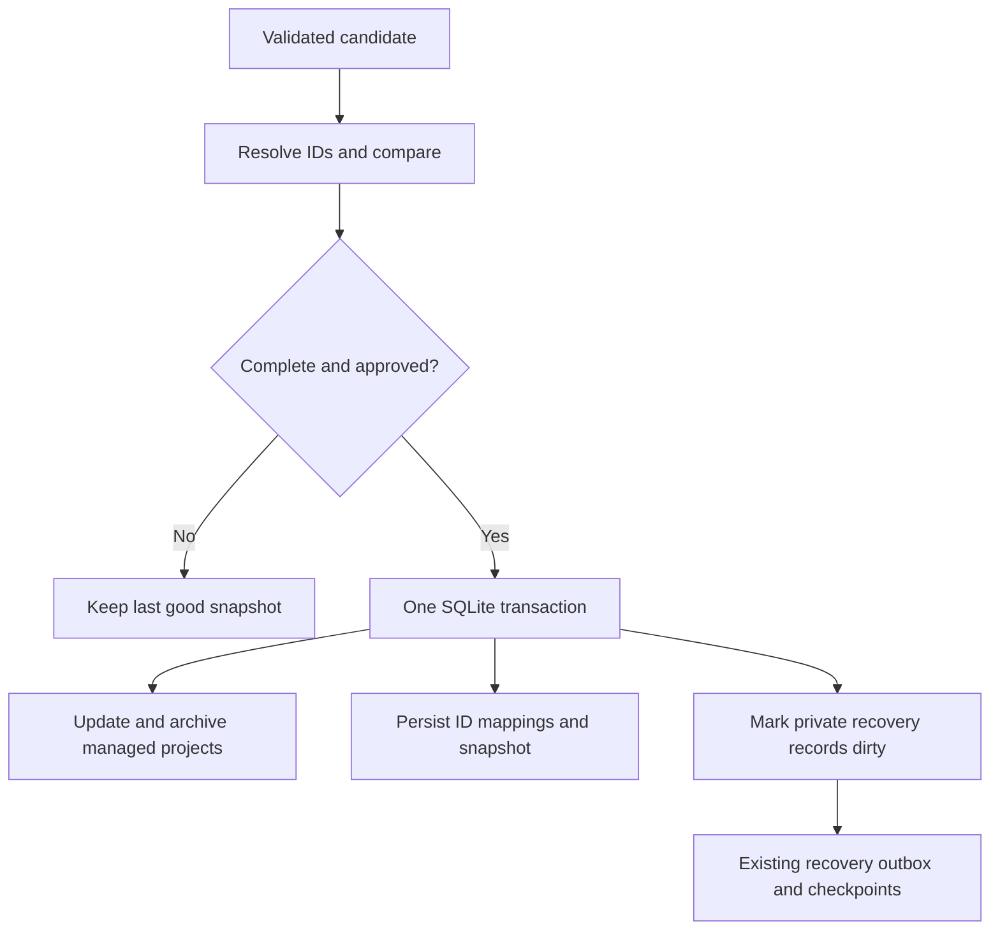

# 02 · Catalog identity, compatibility, and recovery

## Objective and dependencies

After [step 01](01-source-contracts.md), make projects from any supported source usable by the existing picks/payment system. Preserve target identity and the ability to recover while the source is offline.

## Code touchpoints

- [Model](../../../src/lib/model.ts), [repository](../../../src/lib/repository.ts), [SQLite helpers](../../../src/lib/db.ts), and [database migrations](../../../src/lib/database-migrations.ts).
- [LibCard importer](../../../src/lib/libcard.ts) and [metadata schema](../../../src/lib/libcard-schema.ts).
- [Recovery model](../../../src/lib/recovery-model.ts), [tracking](../../../src/lib/recovery-tracking.ts), [import](../../../src/lib/recovery-import.ts), and [control](../../../src/lib/recovery-control.ts).
- [Protocol migration](../../../src/lib/protocol-migration.ts), [Studio actions](../../../src/pages/api/studio.ts), and every public publishing guard that currently checks `.libcard`.
- Proposed `src/lib/catalog/managed-project.ts`, `identity.ts`, `store.ts`, and `reconcile.ts` modules.

## Stored model and LibCard compatibility

Introduce a generic managed-target accessor used by selectors, checkout, presentation, and publication guards. Retain existing `Project.libcard` records and their serialization in this release. Add optional `Project.catalog` metadata for other sources; reject a project containing both. The accessor exposes common fields without forcing a wholesale record rewrite.

New metadata includes `sourceId`, `sourceItemKey`, kind, destination, source presence, source visibility, local hidden state, source aspiration, and optional local aspiration override. Native project minimum lengths and HTTPS rules remain unchanged; only validated managed targets use short labels and separate non-HTTPS destination metadata.

Persist new sources in SQLite KV with explicit schemas:

| Namespace | Data | Recovery |
| --- | --- | --- |
| `catalog-source` | Source ID, adapter, accepted URL, activation generation, new-item policy, paused state | Private portable configuration; no secrets |
| `catalog-snapshot` | Last accepted normalized document, validators, adapter version, observation timestamps | Private recovery |
| `catalog-item` | One source-key-to-project-ID mapping/tombstone per entry | Private recovery |
| `catalog-refresh` | Attempts, next retry, sanitized error code | Operational/disposable |
| `catalog-preview` | Expiring, administrator-bound proposed connection/diff | Ephemeral; not recovery |

Keep the existing `libcard/snapshot` authoritative for legacy LibCard imports. The generic reader wraps it rather than creating a second independently mutable copy. Adopt legacy configuration into a stable source identity without changing `creator`, explicit IDs, `auto-*`, or historical `preview-*` IDs. Reuse the existing legacy write format behind the common lifecycle interface.

A v1 instance has one active source, but retains inactive source metadata and projects needed by payments. Environment-managed `LIBCARD_REPO` remains supported. Proposed `CATALOG_SOURCE_URL` and `CATALOG_SOURCE_TYPE=auto|manifest|linktree|biosites|beacons|website` provide deployment configuration; conflicting legacy/new sources fail with a helpful setup error. Environment configuration locks source connection fields in Studio, while local hide/aspiration overrides remain editable. With no environment source, Studio's persisted connection is authoritative.

## Stable IDs and reconciliation

Allocate an opaque persistent source ID once. For new providers, map `(sourceId, sourceItemKey)` to an immutable project ID within the existing slug format. Prefer a provider's documented stable item ID; otherwise derive a key from kind and conservatively normalized destination. Preserve query strings, path case, and meaningful fragments; do not strip tracking parameters or follow short links speculatively. Hash-based IDs must have collision detection, with mappings stored transactionally.

Titles, icons, order, and groups must never determine identity. Without stable provider IDs, a changed destination is a removed item plus a new candidate, not an automatic match. Duplicate destinations with distinct provider IDs can remain separate; ambiguous duplicates without IDs require a preview decision. Persist that resolution; do not assign identities from changing list positions.

| Source change | Effect |
| --- | --- |
| Same key, new title/order | Update source presentation; preserve ID, creation time, overrides, picks |
| Same stable provider key, new destination | Show the change in Studio; re-review affected pending gifts before final checkout |
| Explicit source skip/hidden state | Archive; omit from public catalog and new checkout selections |
| Missing item in an accepted complete snapshot | Archive; keep its ID and all financial references |
| Reappearance of the same key | Reactivate unless locally hidden; preserve overrides |
| Local hide | Exclude from visits/API; source remains unchanged |
| Transient or incomplete import | Keep the previous accepted catalog; no inferred deletions |
| Target cap reached | Hold new candidates for selection; never displace existing enabled targets automatically |

The synthesized creator is instance-owned, always available when the catalog is available, and cannot be skipped. Existing LibCard records may retain legacy source metadata for compatibility; new adapters cannot rewrite the creator's identity from page text.

Source switching is a previewed transaction, not a URL edit in place. Retire the old active catalog, activate the new one, and invalidate outstanding reviews through the activation generation. Do not merge projects based on similar titles/URLs across different providers in v1. Historical and recurring gifts retain their original IDs and picks; a future explicit migration tool can map equivalent projects with an audit trail.

## Transaction and recovery boundaries

Extend portable-KV validation, dirty tracking, and migrations together. Seed recovery tracking for adopted source/mapping records. Keep each stored envelope within the existing 200,000-byte limit; normalized snapshots retain the smaller bound from step 01, and mappings are separate records rather than an unbounded blob. Retain tombstones with payment references; do not compact them by a time-only retention rule.

Restore into validated staging state before activation. Check every stored pick, including zero-cent selections, against restored projects; restore snapshots, local overrides, ID maps, source configuration, and inactive historical projects together. Resume fetching only after restore pause ends. A failed first refresh must leave restored data usable. Reject inconsistent duplicate mappings or an active-source pointer without corresponding state.

Keep all managed targets and target-referencing acknowledgments out of public AT Protocol writes. Audit native save/publish/duplicate/update paths, protocol migration, recovery republication, and outbox construction using the new accessor. Private recovery continues through the existing Habitat path. Do not store provider credentials in a manifest, public record, source URL, or portable KV; authenticated adapters would require a separate credential design.

## Validation and checklist

- [ ] Capture legacy LibCard snapshots/IDs as regression fixtures before refactoring.
- [ ] Add shared managed-target access and guards without changing native validation.
- [ ] Test rename/reorder, collisions, duplicate destinations, skip/unskip, hide/unhide, cap pressure, and source switching.
- [ ] Test transaction rollback and interruption between normalization and commit.
- [ ] Restore old LibCard-only backups and new multi-history backups with all network access disabled.
- [ ] Verify every payment/pick reference survives restoration, including archived and zero-cent targets.
- [ ] Cover public-publishing rejection for both metadata shapes.
- [ ] Document upgrade/rollback constraints: older releases cannot safely read newly introduced catalog records; preserve a pre-upgrade backup and never discard new payments to roll back code.
