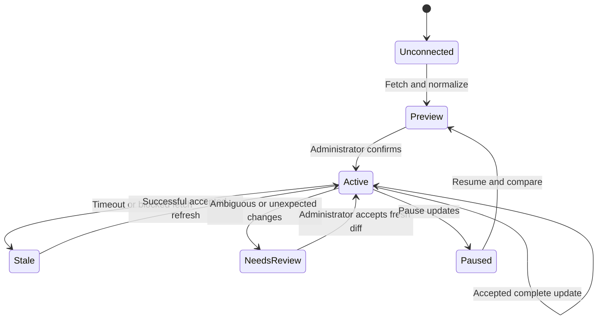

# 03 · Readers and automatic synchronization

## Objective and dependencies

Build the transport/adapters validated in [step 01](01-source-contracts.md) against the lifecycle and storage in [step 02](02-catalog-and-recovery.md). Keep fetch failures outside the checkout path.

## Code touchpoints

Extend [public-network.ts](../../../src/lib/public-network.ts) and its [tests](../../../tests/public-network.test.ts); reuse [LibCard refresh](../../../src/lib/libcard.ts) behavior and [the sync endpoint](../../../src/pages/api/sync.ts). Proposed modules: `catalog/fetch.ts`, `catalog/refresh.ts`, `catalog/adapters/{libcard,manifest,linktree,biosites,beacons,website}.ts`. Create provider modules only when their feasibility gate passes.

`cheerio` is currently a development dependency. If HTML parsing ships in the server runtime, declare it as a direct production dependency or choose an equivalently bounded parser after measurement. Parse documents without running scripts; do not introduce a browser runtime.

## Public transport

Extract a bounded response primitive returning status, selected headers, final approved URL, and bytes/text. Keep `publicJson()` as a compatibility wrapper with its current no-redirect behavior. The general importer needs response headers for ETag/Last-Modified and conditional GETs; it must not weaken the directory's network rules.

Proposed defaults:

- Public HTTPS, port 443, no embedded credentials, no cookies, and no forwarding the user's authorization header.
- Existing DNS validation and connection pinning on every request. Reject mixed public/private DNS answers, private/reserved addresses, and cloud metadata destinations. Validate all redirect/discovery destinations before connecting. This follows the repository's public-fetch precedent and [OWASP's SSRF guidance](https://cheatsheetseries.owasp.org/cheatsheets/Server_Side_Request_Forgery_Prevention_Cheat_Sheet.html).
- Redirects disabled by default. A reader may allow at most two explicitly validated redirects; a changed origin requires provider allowlisting or creator approval. Never adopt an arbitrary HTML canonical URL as permission to switch origins. Do not change source identity automatically following a domain move.
- Five-second request timeout, 15-second total refresh deadline, one in-flight refresh per source, and bounded request count. Allow up to eight content requests for a documented provider's paginated catalog, within an aggregate 2 MiB budget; stop as partial if more are required. A generic website reads one page plus one same-origin manifest at most. Robot checks have a separately bounded, cached request and share the total deadline.
- LibCard YAML/manifest body cap 256 KiB; HTML cap 1 MiB per response; normalized document cap 128 KiB. Bound decompressed bytes as well as wire bytes; reject unsupported content encoding/type rather than parse a challenge page as a catalog.
- Descriptive Feedme user agent. Cache/evaluate robots rules for public HTML under [RFC 9309](https://www.rfc-editor.org/rfc/rfc9309.html), including failures; robots permission is not provider authorization. Follow approved API access rules for official APIs. Never bypass a denied route.

Do not fetch every outbound URL, favicon, image, or video during import. Initially use approved local icons inferred from known platforms or source icon names. Arbitrary remote thumbnail import is a later, separately bounded media feature; it must not turn into a new SSRF route. Preserve existing LibCard GitHub-star enrichment and its independent failure handling.

## Adapter output and completeness

Separate fetch from pure parse/normalize functions. Detect by approved host patterns first; custom domains can use validated provider markers or an explicit provider choice. A marker is a parser hint, not identity proof.

LibCard and the manifest have explicit versioned schemas. Hosted-page adapters must recognize the expected public profile, visible sections, and completion/pagination markers. An HTML 200 response by itself is not success. Never read unpublished destinations from hydration payloads or follow a locked-link redirect to uncover content.

Generic websites initially support either the manifest or a reviewed candidate import from a selected content region. Ignore navigation/footer and executable controls. Do not persist arbitrary JavaScript or executable selector rules. Automatic generic HTML refresh is a later capability gate requiring stable saved extraction rules and reliable completeness checks; an LLM-generated interpretation is not a financial catalog authority.

## Scheduling and reconciliation

Reuse the existing authenticated sync loop; add no scheduler service. Start at 15-minute minimum intervals for LibCard/manifests and 60 minutes for approved HTML readers, with jitter. Honor provider minimums and `Retry-After`; apply bounded exponential backoff (up to 24 hours) on repeated failures. Manual refresh is rate-limited and coalesced rather than bypassing backoff/rate limits indiscriminately. A 1 MiB HTML page fetched hourly is at most roughly 24 MiB/day before validator savings, excluding bounded auxiliary requests; measure actual traffic before promising negligible bandwidth.

Store ETag and Last-Modified where available. On 304, update observation time without changing content or IDs. Fetch unconditionally after an adapter/schema version change; a 304 cannot validate a parser's new interpretation. Content hashes describe bytes/normalized content as labeled, never fictitious commit SHAs.

Apply these rules explicitly:

- Full structured snapshots with valid skips/removals can reconcile automatically under the chosen new-item policy. Source `skip` and local hide always take precedence.
- Hosted HTML with missing/changed parser markers, unknown completeness, or truncated pagination never commits. Show diagnostics and keep last-good state.
- Even a recognized HTML layout needs review when it becomes empty or loses at least half its enabled source targets. This starting threshold is a safeguard, not proof of completeness; measure false positives. Explicit known hidden/skipped items can be withheld immediately without treating every absent item as removed.
- New targets are activated only if the creator opted into automatic additions and capacity permits. Otherwise store them as pending candidates. Once identities are assigned, reordering cannot change which existing targets remain enabled.
- A source change during an in-flight fetch, restore pause, or newly applied local override must be checked again at commit. Apply current local overrides inside the transaction; stale jobs cannot overwrite newer connection state.
- With no successful snapshot, show an unavailable catalog and return API 503. Do not silently fall back to native projects. With stale data, serve the last accepted catalog and expose the condition in Studio. A pause stops fetching; disconnect requires an explicit choice to keep a manual copy or retire targets.
- Source removal/skip affects new gifts. Existing recurring subscriptions continue with their original allocations/picks until canceled or explicitly changed through the existing billing flow. Never silently redistribute them.

Keep sanitized error categories and times in Studio: unavailable, rate-limited, access denied, unsupported layout, invalid data, needs review. Do not log source bodies, authorization headers, or query secrets. A sync job response should expose that this subtask needs attention even if the broader outbox job succeeds.

## Validation and checklist

- [ ] Extend public transport with injected DNS/HTTPS dependencies and maintain old consumer behavior.
- [ ] Test redirects, rebinding, mixed-address DNS, timeouts, oversized/decompression responses, content types, and robots handling.
- [ ] Implement the LibCard compatibility adapter and manifest reader first.
- [ ] Add each hosted-provider reader only with documented access and representative fixtures.
- [ ] Test 304, parser upgrades, concurrency, restore pause, source switch, Retry-After, and failed refresh retention.
- [ ] Test complete empty catalogs versus HTML challenges and incomplete pages; prove no accidental mass archival.
- [ ] Measure requests/bytes/memory and demonstrate that checkout makes no source-site requests.
