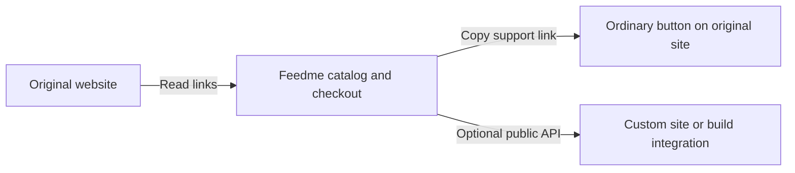

# 04 · Connection flow, visits, and public integration

## Objective and dependencies

After [catalog/recovery](02-catalog-and-recovery.md) and [readers/sync](03-readers-and-sync.md), make connecting a website understandable without asking creators to learn adapter terminology.

## Code touchpoints

- [Projects Studio page](../../../src/pages/studio/projects/index.astro), [LibCard panel](../../../src/components/LibcardStudio.astro), and [Studio API](../../../src/pages/api/studio.ts).
- [PickVisit](../../../src/components/PickVisit.astro), [PickRow](../../../src/components/PickRow.astro), [checkout route](../../../src/pages/checkout.astro), [pick reviews](../../../src/lib/pick-checkout.ts), and [checkout API](../../../src/pages/api/checkout.ts).
- [Public aggregation](../../../src/lib/libcard-public.ts), [LibCard API](../../../src/pages/api/public/libcard.ts), and [middleware](../../../src/middleware.ts).
- Proposed `SourceStudio.astro`, `/studio/sources`, and `/api/public/catalog`.

## Connect a website

Use server-rendered pages and ordinary forms. JavaScript may improve preview feedback and batch selection, but the complete flow must work without it.

| Screen | What the creator sees | Action |
| --- | --- | --- |
| Source entry | “Where do you keep your links?” with URL field and supported-source help | Preview links |
| Preview | Detected provider, update capability, checked time, titles/icons, destinations, groups, excluded items, and target capacity | Select links and connect |
| Connected | Last successful update, next attempt, counts, pending changes, useful status | Refresh, review changes, pause, switch, or disconnect |
| Per-item settings | Source fields read-only; local hidden state and aspiration controls | Save local overrides |
| Finish | Copyable Feedme URL and per-item links | Add a support button to the original site |

Require existing administrator authorization and same-origin/CSRF protection for all fetch/commit/override actions. The preview is not a public arbitrary-URL proxy. Bind its opaque token to the administrator session, source identity, snapshot hash, and current activation generation; expire it after 30 minutes. Store it locally, with no notes, credentials, or source documents in URL parameters. Reject a stale token or changed active source; require another preview after an expired/replaced candidate.

Default **Keep this list updated** on only for a proven automatic reader. Default **Include new links automatically** on for clearly recognized ordinary link/social sections; explain that visibility changes affect new visitors. Generic reviewed/manual imports offer no misleading auto-sync toggle. Under explicit selection, new entries go to a pending list. Over-cap previews require reducing the selection to at most 99 source targets.

Show **Skipped on your website**, **Hidden in Feedme**, **Not selected**, **Removed from source**, and **Needs review** as different states. Source skips cannot be overridden with a local Unhide button. Keep the creator target available. Bulk selection never bypasses source skips or gated-content exclusions.

An aspiration supports **Use source value**, **No aspiration**, or **Custom amount**. Show a quiet dollar aspiration with the existing managed-target presentation. Real progress, where currently shown, comes exclusively from verified Feedme payments under existing visibility rules; never infer it from external shop sales, source counters, or sample data. A source with no goals can still be fully usable.

## Visitor experience and account identity

Use the current visual system and pick interactions for every source. Provider names belong in compact source attribution or Studio, not repeated beside every selection. Keep title links separate from pick controls and open external destinations in new tabs with appropriate `rel` attributes. Local icons and existing spacing keep the UI consistent even when a provider supplies no images.

Bluesky supplies the creator's name/handle/bio/avatar under the existing identity rules. An imported card's promotional text or site title must not replace the bio. Preserve explicit Bluesky sign-in guidance, account creation help, and the anonymous path throughout review. Importing a Linktree does not require visitors to have Linktree accounts.

Keep one-time/monthly/yearly choices, configured tip amounts, original integer picks, exact cent allocation, browser-bound drafts, and Stripe behavior. Replace LibCard-specific source checks with the shared active-source identity and activation generation. Existing unexpired legacy drafts may continue under an unchanged legacy source; a switched source requires review again.

Review freezes the selected target IDs and relevant content revision (label/destination), not the entire source's unrelated ordering. If a selected target disappears, is hidden, or changes meaning/destination before confirmation, require a fresh review. An unrelated newly added target should not invalidate a reviewed gift. Payment submission still verifies identity, privacy, and eligibility server-side; checkout redirects never prove payment.

Preserve source-derived targets in receipts, share pages, analytics, and recurring history through the shared managed-target accessor. Never regenerate picks from rounded cents or treat imported website data as ledger data.

## Integration back into the original website

There are two separate directions:

The universal return path is an ordinary link to the creator's Feedme `/checkout`. An individual target links to `/checkout?<targetId>=1`, optionally with the configured amount using URL APIs. The external site does not collect payment details. Do not promise inline public percentages or per-row buttons on a hosted platform that does not permit custom markup/scripts; those require an actual supported platform integration. LibCard's existing build integration continues independently.

## Public API compatibility

Add `GET`/`HEAD /api/public/catalog` with the same allowlisted response shape as the current LibCard endpoint: `creatorName`, trusted configured `origin`, `defaultAmountCents`, and targets containing `id`, `label`, `url`, `kind`, `publicCount`, and `publicShareMillis`. Do not add raw provider documents, source configuration, mappings, donor identities, notes, or payment amounts.

Extract the aggregator so both endpoints share privacy and raw-pick rules. The new endpoint uses the displayed creator identity; preserve the exact existing LibCard endpoint contract and activation semantics, including 404 when LibCard is disabled. The legacy endpoint is not silently repurposed for a different provider.

Return 404 without an active catalog, uncached 503 before its first accepted snapshot, and 60-second public caching for successful session-independent GET/HEAD. Extend the middleware exception narrowly by exact route/method/status. Signed-in Studio, previews, and checkout remain private/no-store. Do not introduce permissive credentialed CORS; ordinary links and server-side build consumers do not require it. Browser widgets are deferred.

## Validation and checklist

- [ ] Exercise connect/preview/select/refresh/hide/skip/pause/disconnect/source switch with JavaScript disabled.
- [ ] Cover unauthorized fetches, CSRF, expired previews, stale generations, and concurrent administrators.
- [ ] Confirm useful mobile layout, keyboard focus, labeled controls, and clear source-status messages.
- [ ] Verify labels/identity on visits, review, receipts, share pages, and Studio across all source modes.
- [ ] Test sign-in/edit/anonymous review round trips, selected-item changes, idempotency, and recurring history.
- [ ] Prove both public endpoint privacy rules, cache isolation, source ordering, and exact thousandths totals.
- [ ] Confirm existing LibCard client fixtures need no changes to keep working.
