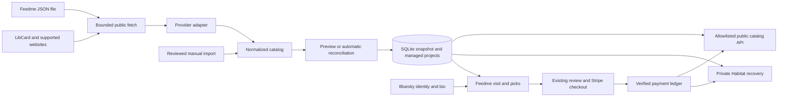

# Website sources for Feedme

**Status: proposed; planning only · researched 2026-10-12.** No adapter, configuration, or deployment is changed by this plan. The folder name `website-sources` is inferred from the request to support both link-in-bio platforms and personal websites.

Let a creator connect the website they already maintain, preview its links, and turn those links into suggestions for an unconditional tip. Keep LibCard working as it does today; make it one supported source alongside other providers.

## Motivation and proposed experience

The creator should maintain their links in one place. They should not need to learn an import format or maintain two lists just to accept support through Feedme.

1. Open **Dashboard → Projects → Connect a website** and paste a Linktree, Bio Site, Beacons, or personal website URL.
2. Feedme detects a supported source and shows the actual links it can read, with titles, groups, and available icons. It explains whether updates can be automatic or require another import.
3. Review the selections. Eligible links and socials start selected; navigation, provider branding, gated content, and other checkout flows do not become tip suggestions automatically. Choose whether newly discovered links should become selectable automatically.
4. Connect the source. Add optional aspirations in Feedme, hide individual items, and continue editing source titles and links on the original website.
5. Copy a **Support me** link back to the original site. Where that site supports ordinary link buttons, this works without a custom widget. Per-item tip links remain available from Feedme.

Visitors use the existing plus/minus picks, percentages, review page, Stripe checkout, and privacy choices. Bluesky remains the source of identity, handle, and bio. A website import must never change the payment recipient or administrator.

## Current state in the repository

| Area | Existing behavior | Extension |
| --- | --- | --- |
| Import | [LibCard parser](../../../src/lib/libcard-schema.ts) reads a bounded public YAML document | Provider adapters produce a common validated link catalog |
| Targets | [Catalog](../../../src/lib/libcard-catalog.ts) handles explicit IDs, automatic IDs, skips, and the 99-source-target limit | Stable source-item mappings for additional providers |
| Persistence | [Importer](../../../src/lib/libcard.ts) transactionally saves managed projects and a last-good SQLite snapshot | Reuse those lifecycle rules across sources |
| Refresh | [Sync endpoint](../../../src/pages/api/sync.ts) calls LibCard refresh; importer checks at most every 15 minutes | Source-specific polling/backoff in the existing worker |
| Identity | [Profile overlay](../../../src/lib/libcard.ts) prefers cached Bluesky identity and never replaces its bio with the card tagline | Keep website catalogs separate from account identity |
| Checkout | [Pick checkout](../../../src/lib/pick-checkout.ts) binds drafts to a browser and LibCard source | Bind to a generic active source without changing allocation/payment rules |
| Administration | [From LibCard panel](../../../src/components/LibcardStudio.astro) exposes hidden state and aspiration overrides | Add source preview, connection state, and import diagnostics |
| Public contract | [Public endpoint](../../../src/pages/api/public/libcard.ts) returns allowlisted targets and public pick signals | Add a generic endpoint while preserving the LibCard contract |
| Recovery | [Recovery model](../../../src/lib/recovery-model.ts) and [tracking](../../../src/lib/recovery-tracking.ts) retain projects, picks, and the LibCard snapshot privately | Include new source settings, mappings, and snapshots |
| Network safety | [Public transport](../../../src/lib/public-network.ts) validates HTTPS/DNS and pins public addresses | Extend transport for bounded text and conditional requests without weakening existing JSON consumers |

The difficult part is obtaining a trustworthy, complete list from each provider. Payment allocation and the visitor UI already exist.

## Provider research and support levels

These are documentation findings, not tested integrations. No representative creator pages, authenticated provider accounts, or partner APIs were exercised during this planning pass.

| Source | Verified evidence | Proposed approach |
| --- | --- | --- |
| LibCard | Feedme already consumes its public YAML and supports source skips | Preserve this as the reference adapter |
| Linktree | Its [developer program](https://linktr.ee/marketplace/developer) invites expressions of interest for API/SDK access; it does not document a generally available full-catalog reader there | Investigate official access first; release a public-page adapter only after permission, completeness, and stability checks |
| Squarespace Bio Sites | Official help documents [links, icons, and locked links](https://help.unfold.com/hc/en-us/articles/18892455799565-Managing-Bio-Site-sections) and [social links](https://help.unfold.com/hc/en-us/articles/40545009633677-Adding-Social-Links-and-Posts-to-BioSites) | Investigate a public-page adapter for visible link/social sections; do not expose locked destinations |
| Beacons | Its [Links Block](https://help.beacons.ai/en/articles/4696577) supports schedules and redirects. The published [Brands API](https://help.beacons.ai/en/articles/11826369) help page does not list catalog endpoints | Investigate visible link/social blocks; do not assume the Brands API provides creator-page exports |
| Any owned website | A site can deliberately publish a small Feedme JSON file; this is a proposed Feedme contract | Offer a dependable manifest adapter, plus reviewed HTML import where feasible |

No public catalog API was verified for the three hosted providers. That is an implementation research gate, not a claim that private or partner APIs do not exist. Do not promise automatic integration until a provider passes [step 01](01-source-contracts.md). A public page is not evidence that automated access is permitted.

Expose three honest capabilities: **automatic updates**, **reviewed import**, and **manual list**. A reviewed import copies an approved list but does not promise background synchronization. All three can provide a useful Feedme; only supported readers claim automatic updates.

## Goals and non-goals

Goals:

- One clear connection flow with preview, source visibility, local exclusions, and useful errors.
- Automatic updates for validated sources; a portable manifest for any site that can publish a file.
- Stable references across edits, outages, refunds, recurring gifts, and private recovery.
- Existing LibCard configuration, IDs, URLs, skips, and consumer contracts keep working.
- Small TypeScript adapters, SQLite reads during visits, and the existing deployment model.

The first release uses one active catalog source per instance. Multi-source merging, bidirectional editing, a hosted scraping service, headless browsers, AI extraction, and automatic publishing of imported targets to AT Protocol are deferred. It does not import audiences, sales, external balances, or product entitlements. A tip is still unconditional; it does not buy a product linked from another site.

## Architecture

The source controls imported content; Feedme controls local visibility and aspirations; Bluesky controls identity; Stripe events establish payment state. SQLite serves the application, and private Habitat recovery retains enough logical state to recover without the original website being available.

Do not introduce a central coordinator. Each self-hosted instance fetches its configured source on a modest schedule. The GitHub Pages demo uses offline fixtures and does not become a crawler or backend.

## Execution sequence

| Step | Deliverable | Dependency |
| --- | --- | --- |
| [01 · Source contracts and feasibility](01-source-contracts.md) | Provider capability matrix, normalization rules, portable manifest | Current importer and provider documentation |
| [02 · Catalog identity and recovery](02-catalog-and-recovery.md) | Shared managed-target model, stable IDs, backward compatibility | Step 01 contract |
| [03 · Readers and synchronization](03-readers-and-sync.md) | Safe transport, gated adapters, transactional refresh, last-good behavior | Steps 01–02 |
| [04 · Connection and visitor experience](04-studio-and-visits.md) | Preview/connect UI, local settings, checkout/API integration | Steps 02–03 |
| [05 · Verification and rollout](05-verification-and-rollout.md) | Migration tests, provider fixtures, documentation, staged release | Steps 01–04 |

Recommended first slice: preserve LibCard, add the common source boundary and manifest reader, then ship the first hosted-provider adapter that passes its feasibility gate. Evaluate all three requested providers early; do not hold reliable integrations hostage to a provider that blocks access. Generic HTML import begins as a reviewed import; promote saved extraction rules to automatic sync only after validation.

## Risks and remaining decisions

- **Provider access:** the API/HTML route remains unverified for Linktree, Bio Sites, and Beacons. Record actual access conditions and examples before selecting dependencies or promising support.
- **Layout drift:** HTML readers can mistake a login/challenge page or incomplete layout for an empty catalog. Preserve the last-good catalog and require review on suspicious changes.
- **Identity:** importing a URL does not prove ownership. Require an administrator to authorize the source, but do not invent a verified-owner badge. Existing Bluesky identity and directory verification remain separate.
- **Portability:** providers may offer only tracked URLs, not stable item IDs. Exact destination matching has limits; ambiguous identity changes need explicit review.
- **Freshness and bandwidth:** proposed polling defaults are 15 minutes for LibCard/manifests and 60 minutes for public HTML, subject to provider requirements. They are not real-time guarantees.
- **Limits:** a Bio Site can have more source links than Feedme's 99 target slots. Explain the cap and require selection rather than silently dropping or replacing live targets.
- **Configuration:** v1 permits one active source, with an environment-managed source taking precedence over Studio. Conflicting legacy/new environment sources produce a setup error.

These are technical validation gates with recommended defaults. No product answer is required before beginning the future feasibility phase.

## Implementation checklist

- [ ] Validate provider access and create representative fixtures.
- [ ] Define shared catalog types and the manifest schema.
- [ ] Preserve LibCard while extending target identity, recovery, and publishing guards.
- [ ] Implement bounded readers and automatic/reviewed synchronization states.
- [ ] Add the Studio connection flow, visitor support, and generic public endpoint.
- [ ] Document actual provider support and roll out verified adapters individually.

## Validation checklist

- [ ] Existing LibCard IDs, skips, prefills, public contract, and disabled behavior remain compatible.
- [ ] Rename, reorder, removal, reappearance, source switch, and restoration preserve financial references.
- [ ] Incomplete fetches cannot archive a catalog; unavailable targets cannot silently change a reviewed gift.
- [ ] SSRF, injection, access restrictions, size caps, and throttling are covered with fixtures.
- [ ] Bluesky bio/handle, native projects, anonymous tips, recurring payments, and private recovery remain correct.
- [ ] Run the repository checks and browser acceptance cases in step 05 before shipping implementation.

## References

- Existing [LibCard guide](../../libcard.md), [recovery guide](../../backups-and-recovery.md), and [original picks plan](../0001_[_]_LIBCARD_PICKS.md).
- Existing [directory plan](../creator-directory/README.md) and [collection step](../creator-directory/02-collection-and-verification.md), which provide the planning format and public-fetch precedent.
- Provider sources are linked beside their claims above. Research establishes documented capabilities, not successful integration tests.
- [OWASP SSRF guidance](https://cheatsheetseries.owasp.org/cheatsheets/Server_Side_Request_Forgery_Prevention_Cheat_Sheet.html) and [Robots Exclusion Protocol](https://www.rfc-editor.org/rfc/rfc9309.html) inform the transport/access review in step 03.
